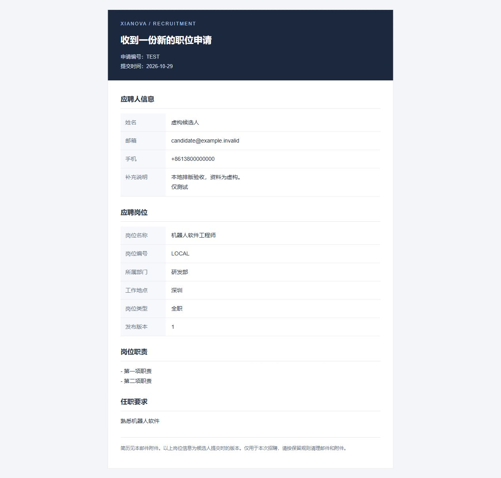
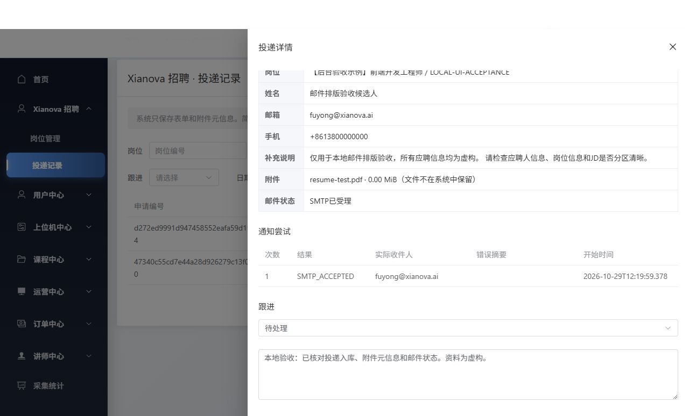
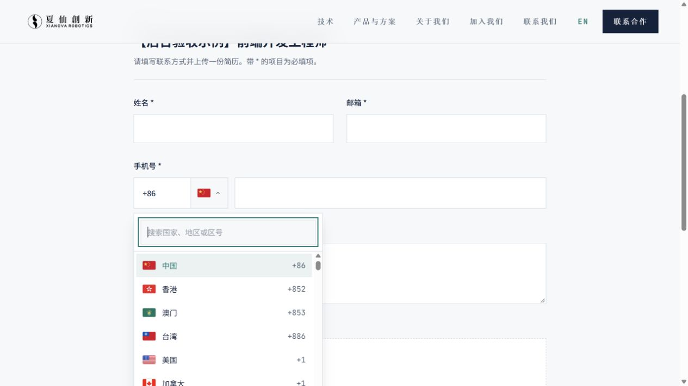
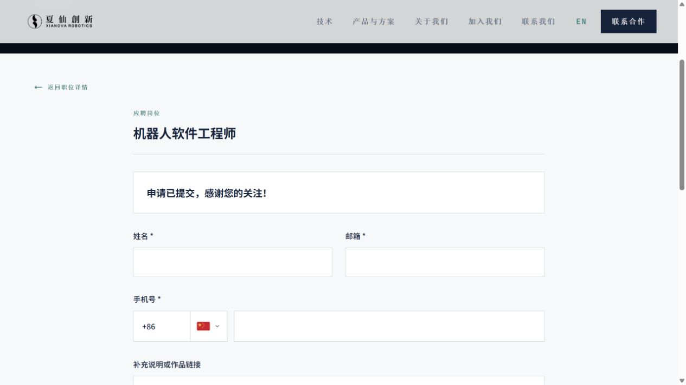

# 招聘功能本地验收

日期：2026-10-29  
需求基线：[PRD_v2.2.md](./PRD_v2.2.md)  
状态：本地验收后，Sparkling后端与管理后台已按后续授权部署开发服务器；官网前端未部署，生产未发布。原有本地记录保留供追溯，当前开发环境结论见第11节。

## 1. 验收入口

| 入口 | 地址 |
| --- | --- |
| 官网岗位列表 | http://localhost:3000/zh/careers |
| 英文页面 | http://localhost:3000/en/careers |
| 岗位管理 | http://127.0.0.1:5175/#/admin/xianova-recruitment/jobs |
| 投递记录 | http://127.0.0.1:5175/#/admin/xianova-recruitment/applications |
| 后端配置检查 | http://127.0.0.1:8081/api/xianova/recruitment/form-config |

后台使用用户提供的现有开发管理员登录；密码不重复写入文档。旧后台登录与业务API仍指向原开发服务，仅新增招聘API指向本地8081。

原带测试标记的 `LOCAL-ACCEPTANCE` 和 `LOCAL-UI-ACCEPTANCE` 已下线。官网当前只展示 `ROBOTICS-SOFTWARE-001`（仅中文）及 `FRONTEND-ENGINEER-001`（完整中英文）。

## 2. 已验证

| 检查 | 结果 / 证据 |
| --- | --- |
| 官网构建 | `npm run build`通过，新增列表、详情和申请路由已产出。 |
| 官网静态检查 | `npm run lint`、TypeScript noEmit通过。 |
| 前端文件限制 | Node测试2项通过；浏览器选择10 MiB+1字节立即提示“尚未上传”，精确10 MiB可提交。 |
| 后台构建 | `npm run type-check`、`npm run build:dev`、变更文件定向ESLint通过；仅有原构建大chunk提示。 |
| 后端测试 | RecruitmentUploadTest、RecruitmentConfigurationTest、RecruitmentDatabaseTest及旧EmailContactNotificationClientTest、WebsiteContactServiceImplTest通过。数据库测试显式启用，样例初始化测试默认跳过。 |
| 数据库集成 | 验证草稿隔离、版本冲突、下线、手机必填、幂等及并发重复仅发一次、token错误和到期、UNKNOWN不重发、60秒间隔、最多3次、登记中断补传、关联物理清理。仅测试自建记录，结束清理。 |
| 邮箱隔离 | Spring上下文仍只有原MailSender Bean，新招聘内部客户端使用独立主机；旧联系模块单测通过。 |
| 邮件内容 | MIME测试检查固定To、候选人Reply-To、安全附件名、附件原字节、HTML和纯文本版本、JD换行、输入转义及不输出JSON。 |
| 公开跨域 | localhost:3000预检200；不可信Origin403；公开响应不携带Allow-Credentials。 |
| 管理鉴权 | 匿名管理session返回401，服务层普通USER返回403；真实开发管理员登录成功。 |
| 早期超限 | 11 MiB+1字节请求返回413且包含正确CORS响应头，浏览器可读错误。 |
| 管理员流程 | 浏览器创建草稿、确认发布，官网出现新岗位；详情与申请可用。 |
| 投递与持久化 | 浏览器两次真实提交均SMTP_ACCEPTED，后台详情、附件元信息、通知尝试与跟进备注已核对。 |
| 英文回退 | 英文详情缺译时展示中文JD，并有明确回退提示。 |

日志均在后端 `runtime-logs/`；官网及后台构建日志也集中放在该目录。未运行后台全仓带--fix的lint，未更改旧上传500MB配置。

## 3. 真实邮件测试

| 申请编号 | 用途 | 结果 |
| --- | --- | --- |
| `47340c55cd7e44a28d926279c13f0b80` | 精确10,485,760字节PDF；虚构候选人。 | SMTP已受理，用户已看到旧版正文并反馈可读性问题。 |
| `d272ed9991d947458552eafa59d1f444` | 小PDF；邮件排版验收虚构候选人。 | SMTP已受理，新版正文按应聘人 / 岗位 / 职责 / 要求分区，不再输出JSON。 |

收发件均为已确定的 `fuyong@xianova.ai`。没有给旧业务其他联系人发测试邮件。SMTP受理与收件端最终送达、附件打开是不同证据；附件在收件邮箱中的打开情况请用户本地验收确认。测试记录和邮件暂留供验收，验收后按规则清理。

邮件模板示意（虚构资料，展示同一模板）：



后台投递详情：



## 4. 数据库状态

已在授权开发库新增四张 `xianova_recruitment_*` 表，未改旧业务表。新表utf8mb4_0900_ai_ci；95字段、18索引，表 / 字段 / 索引用途备注均为中文。

迁移文件：后端 `src/main/resources/db/migration/common/V20261029035648__create_xianova_recruitment.sql`。库中没有Flyway历史；本次只在确认无同名招聘表后应用这四条CREATE TABLE，不自动baseline，不运行整库migrate。后续不要再次直接执行同一建表文件；部署前按现有迁移规程核对历史和结构。

## 5. 重启方式

后端只启动招聘模块，保留原登录拦截与角色检查，避免启动训练、计费及其他云端任务。测试启动类位于 `src/test/java/com/xianova/local/RecruitmentLocalApplication.java`，不会打进正式运行入口。

```powershell
Set-Location D:\Xianova\Sparkling\Sparkling-Admin-Service
& .\scripts\run-recruitment-local.ps1 -MavenPath 'D:\develop\apache-maven-3.9.4\bin\mvn.cmd' -JavaPath 'D:\develop\java\temurin-17-latest\jdk-17.0.20.1+1\bin\java.exe'
```

已有编译产物时可加 `-SkipCompile`。脚本返回新PID，重启前先确认并停止本次招聘进程，避免8081冲突。真实配置在Git忽略的 `recruitment-local.env`，参考无密钥的 `docs/recruitment-mail.env.example`。脚本为Windows JDK指定本地套接字目录，避免用户TEMP短路径导致启动失败。

官网当前使用本地生产构建启动，验证实际构建产物：

```powershell
Set-Location D:\Xianova\Xianova_Web\Xianova_Web
npm run build
node node_modules/next/dist/bin/next start -H 127.0.0.1 -p 3000
```

继续开发可停止本次3000进程后运行 `npm run dev -- -H 127.0.0.1`。`.env.local`仅有公开招聘API主机 `http://127.0.0.1:8081`，修改后重启 / 重建。

后台：

```powershell
Set-Location D:\Xianova\Sparkling\Sparkling-Admin-Web
npm run dev -- --host 127.0.0.1 --port 5175
```

`.env.local`为新招聘模块设置 `VITE_RECRUITMENT_API_BASE=http://127.0.0.1:8081/api`，不改变原登录API主机。

## 6. 本地验收仍需确认与后续阶段

- 请用户确认新邮件排版和收件端附件打开，以及实际手机断点体验。自动化浏览器本次未获得真实390px视口，不将手机适配视为完整验收通过。
- 故障矩阵中网关断连、数据库发送后回写失败、完整应用上下文和全部desk回归尚未覆盖；已完成的定向测试不替代这些部署前验证。
- 开发 / 生产网关的11 MiB路径限制、可信代理真实IP、Flyway基线、日志轮换、备份恢复删除重放、监控目的地，在用户本地验收后按实际部署系统落实。
- 正式岗位内容、HR凭据及最终公开告知仍为上线准备项；当前测试参数不会直接用于正式招聘。
- 所有修改保留在三个开发分支工作区；原后端deploy示例、后台vite.config.ts既有修改未覆盖。

## 7. 区号选择器追加验收（2026-10-29）

已支持手动输入和国家/地区下拉选择；选项同时显示SVG国旗、名称和区号，可按名称或区号搜索，随中英文界面切换。浏览器已验证英国+44选择、日本+81手动输入、加拿大+1独立选择、方向键/回车/Escape、空结果和英文Japan搜索；phoneCountryCode字段和后端契约保持一致。TypeScript、lint和正式构建通过，新版已本地启动。

区号元数据来源：[libphonenumber-js](https://github.com/catamphetamine/libphonenumber-js)；国旗资源来源：[country-flag-icons](https://github.com/catamphetamine/country-flag-icons)。资源随应用打包，无外部图片请求。



## 8. 最终语言展示规则（2026-10-29）

需求方选择“英文选填，缺译显示中文”。英文非必填，缺英文可保存并发布；英文页对名称、地点、部门、职责和要求逐项选择英文或中文回退，提供缺译提示，后台英文预览一致。中文页固定显示中文，不调用外部翻译接口、不部署翻译模型。两个原测试岗位已有英文，继续保留；历史申请快照不变。

本轮额外执行8项语言选择检查通过，涵盖人工英文优先、空值及空白回退、中文界面、部分内容缺译及部门缺译提示；检查过程中无网络请求。

本轮官网和后台构建、类型检查及lint通过；后端集成测试10项执行通过，1项样例初始化跳过。验证纯中文岗位和部分译文均可发布，人工英文不会被覆盖。集成测试期间暂停本次本地招聘进程，避免两个清理定时器同时处理测试到期记录；完成后已恢复服务。

## 9. 新增岗位内容验收（2026-10-29）

已通过现有管理员接口在开发库新增并发布两条岗位，名称和正文采用正式招聘写法，没有测试声明；原有两条带测试字样的样例已按用户要求下线，官网仅保留这两条岗位。

| 岗位编号 | 岗位名称 | 语言数据 | 英文页预期 |
| --- | --- | --- | --- |
| ROBOTICS-SOFTWARE-001 | 机器人软件工程师 | 名称、地点、部门、职责、要求只填中文，英文均为空。 | 固定界面为英文，岗位内容显示中文并提示缺译。 |
| FRONTEND-ENGINEER-001 | 前端开发工程师 / Frontend Engineer | 上述五项中英文完整。 | 岗位名称、地点、部门、职责、要求均展示英文，不显示缺译提示。 |

- 机器人软件工程师：[中文](http://localhost:3000/zh/careers/ROBOTICS-SOFTWARE-001) / [英文](http://localhost:3000/en/careers/ROBOTICS-SOFTWARE-001)。
- 前端开发工程师：[中文](http://localhost:3000/zh/careers/FRONTEND-ENGINEER-001) / [英文](http://localhost:3000/en/careers/FRONTEND-ENGINEER-001)。

公开接口已核对：两条均为发布版本1，英文填写项分别为0/5和5/5。

当前公开列表已核对仅2条：ROBOTICS-SOFTWARE-001、FRONTEND-ENGINEER-001；旧样例均为OFFLINE，历史申请保留。

## 10. 提交体验及中文附件名验收（2026-10-29）

- 后端本轮25项测试执行通过，1项样例初始化跳过；覆盖UTF-8文件名与历史可逆乱码、阻塞SMTP时先返回、相同候选人新请求再次申请、有界队列繁忙拒绝及原邮件配置隔离。官网类型检查、lint、正式构建通过。
- 浏览器使用虚构资料和小PDF附件，连续提交同岗位两次。开发库核对结果为2条申请、2个不同幂等键、2份正确中文文件名，邮件状态均为SMTP_ACCEPTED；这表示发信服务器受理，不代表已读。
- 首次小附件点击提交至成功提示约742毫秒。接口不再等待SMTP，实际耗时仍受附件上传和网络影响。
- 成功提示为“申请已提交，感谢您的关注！”。表单字段、文件及隐私勾选清空，不展示编号、邮件技术说明或“再次投递”按钮；直接重新填写可正常提交，既有限流仍生效。
- 联系区域为“如有应聘相关问题，欢迎通过邮箱联系我们：”，保留配置邮箱链接；英文同步，不要求候选人提供申请编号。
- 附件只保留在受限内存队列中。邮件发出前异常重启可能需要HR联系候选人补交，此边界已获用户确认。未部署、提交或推送代码。



## 11. 开发环境发布验收（2026-10-29）

开发后台入口：https://dev_manage.sparklingrobo.com/#/admin/xianova-recruitment/jobs 。后端运行`ccee460`，管理后台运行`6fe473d`。使用直接API调用验证投递，不使用或部署官网；仅向已确认的测试收件邮箱发信。新申请幂等重试没有重复记录或通知，SMTP已受理；后台中文附件名、中文筛选、详情与跟进持久化已确认。最终完整本地verify包含独立演练库集成测试：234项，失败0，错误0，跳过7。开发网关及权限边界通过验证，当前启动错误0、重启0。未重复建表或建立Flyway历史，未进行生产发布。完整证据及已知限制见[开发环境发布记录](https://github.com/Synria-Robotics/Sparkling-Admin-Service/blob/codex/xianova-recruitment/docs/recruitment-dev-deployment.md)。
